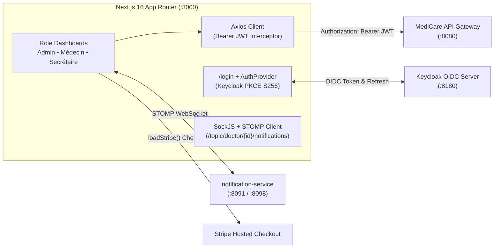
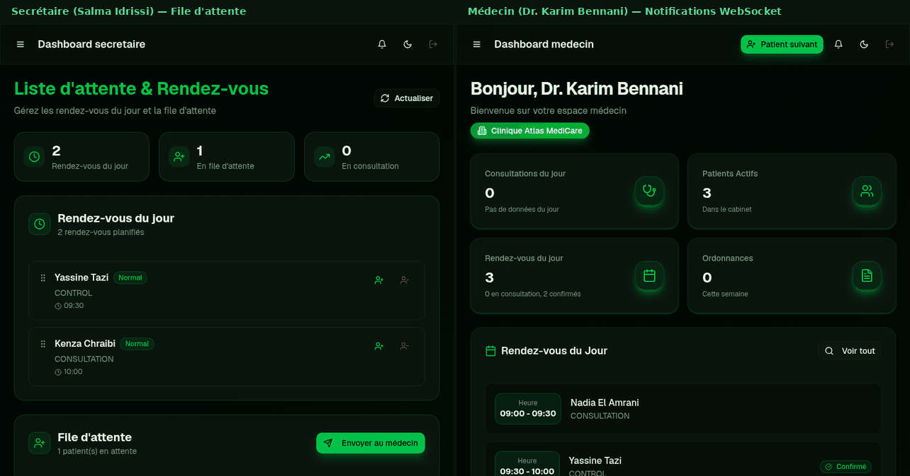
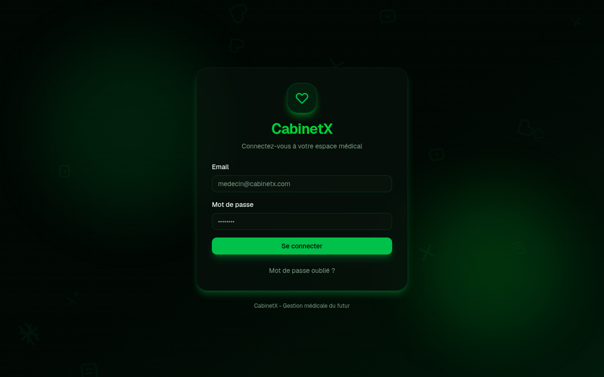
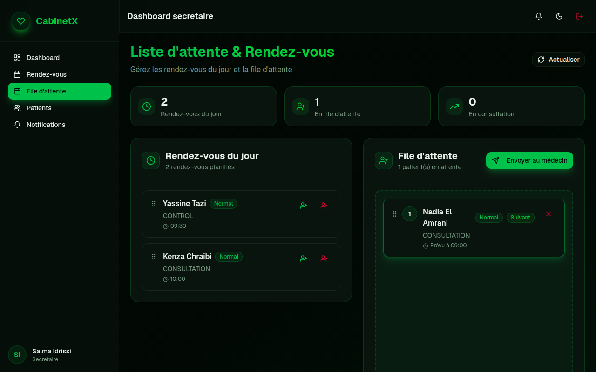
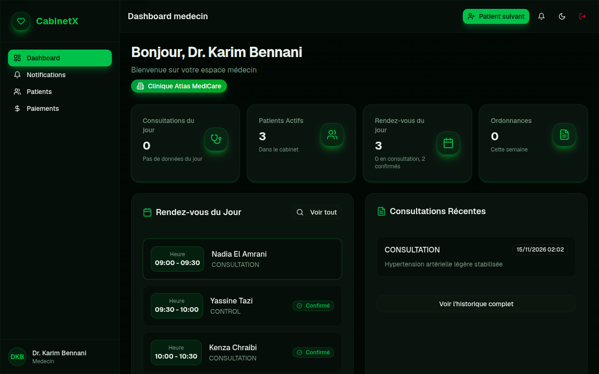
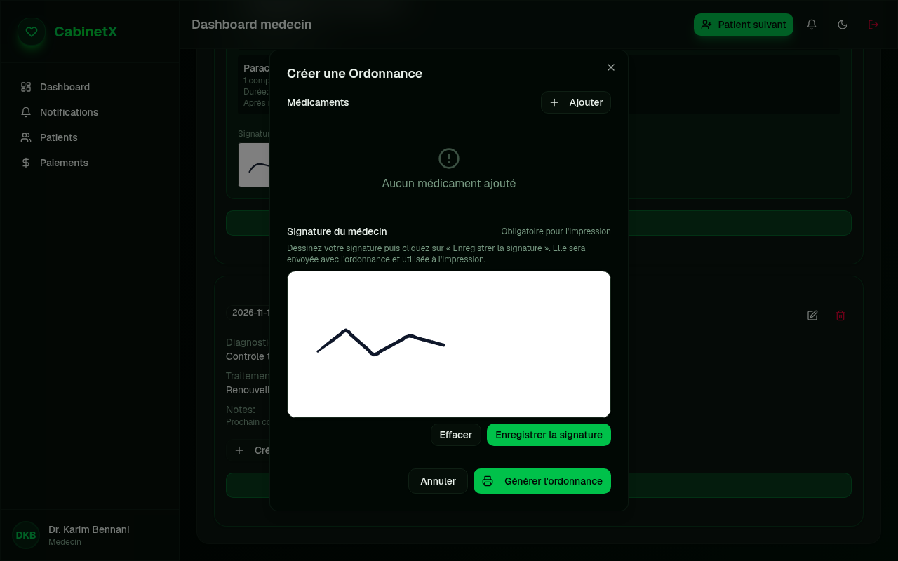
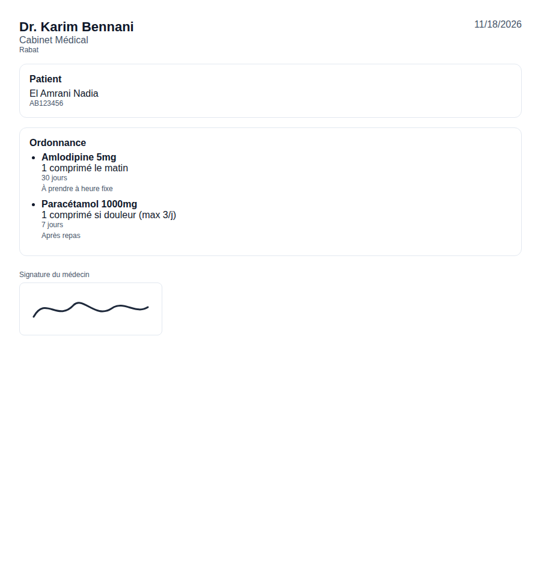
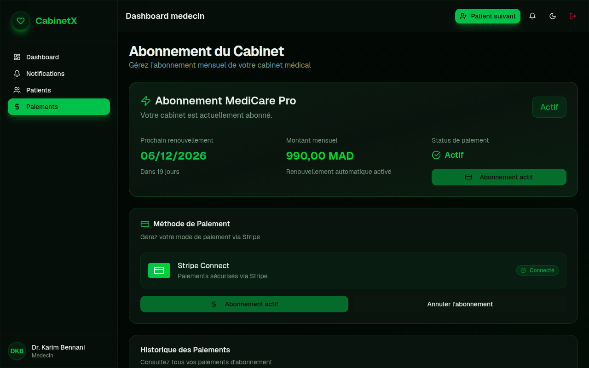

# MediCare — Medical Clinic Management Frontend

[](https://github.com/Majidied/MediCare-frontend/actions/workflows/ci.yml)


Multi-role Next.js web application for **MediCare** (*CabinetX*), a medical clinic management platform supporting **Admins**, **Doctors (Médecins)**, and **Secretaries (Secrétaires)** with Keycloak OIDC authentication, real-time STOMP WebSocket patient queue notifications, consultations, digital signature capture, printable prescriptions, and Stripe billing.

---

## Project Status

**Active / Feature-Complete MVP** — Role portals, STOMP WebSocket alerts, digital signatures, Stripe checkout, Dockerfile, and GitHub Actions CI are configured.

---

## Key Features

- **Role-Based Portals:** Dedicated dashboards for `/dashboard/admin`, `/dashboard/medecin`, and `/dashboard/secretaire` secured with **Keycloak OIDC** (`keycloak-js`, PKCE S256).
- **Real-Time Queue & Notifications:** Live waiting-room queue (`CONFIRME` → `EN_ATTENTE` → `EN_CONSULTATION`) with drag-and-drop reordering and **STOMP over SockJS** (`@stomp/stompjs`) push alerts + audio notification (`notification-sound.mp3`).
- **Clinical Consultations & Prescriptions:** Patient EHR timeline, digital signature pad (`signature_pad`), and formatted printable prescriptions.
- **Stripe Billing & Subscriptions:** Clinic subscription management, plan selection, hosted Stripe Checkout redirect, and invoice history.
- **State & UI:** **TanStack React Query v5**, **React Hook Form + Zod**, **Tailwind CSS**, and **shadcn/ui** (Radix primitives).

---

## Architecture & Auth Flow



---

## Demo & Screenshots

### Real-Time Queue → Doctor WebSocket Notification


### Role Portals & Clinical Workflows

| Login (Keycloak OIDC) | Secretary Queue & Appointments |
| :---: | :---: |
|  |  |

| Doctor Dashboard | Consultation & Digital Signature Pad |
| :---: | :---: |
|  |  |

| Printable Prescription | Stripe Subscription & Invoices |
| :---: | :---: |
|  |  |

---

## Environment Variables

Copy `.env.example` to `.env.local` and configure all 6 public variables:

| Variable | Default / Example | Purpose |
| :--- | :--- | :--- |
| `NEXT_PUBLIC_API_URL` | `http://localhost:8080` | [MediCare-backend](https://github.com/Majidied/MediCare-backend) API Gateway URL |
| `NEXT_PUBLIC_NOTIFICATION_WS_URL` | `http://localhost:8091/ws-notifications` | STOMP / SockJS notifications endpoint |
| `NEXT_PUBLIC_KEYCLOAK_URL` | `http://localhost:8180` | Keycloak server base URL |
| `NEXT_PUBLIC_KEYCLOAK_REALM` | `medicare` | Keycloak realm name |
| `NEXT_PUBLIC_KEYCLOAK_CLIENT_ID` | `medicare-frontend` | Keycloak public OIDC client ID |
| `NEXT_PUBLIC_STRIPE_PUBLISHABLE_KEY` | `pk_test_replace_me` | Stripe publishable key for Checkout redirect |

---

## Getting Started

### Prerequisites

- **Node.js 20+** and **npm** (or Docker)
- Running instances of [MediCare-backend](https://github.com/Majidied/MediCare-backend) and Keycloak

### Local Development

```bash
git clone https://github.com/Majidied/MediCare-frontend.git
cd MediCare-frontend
cp .env.example .env.local
npm install
npm run dev
```

Open [http://localhost:3000](http://localhost:3000).

### Production Build & Docker

```bash
# Local production build
npm run build
npm run start

# Docker build & run
docker build -t medicare-frontend .
docker run -p 3000:3000 --env-file .env.local medicare-frontend
```

---

## License

This project is licensed under the MIT License — see [LICENSE](LICENSE) for details.
